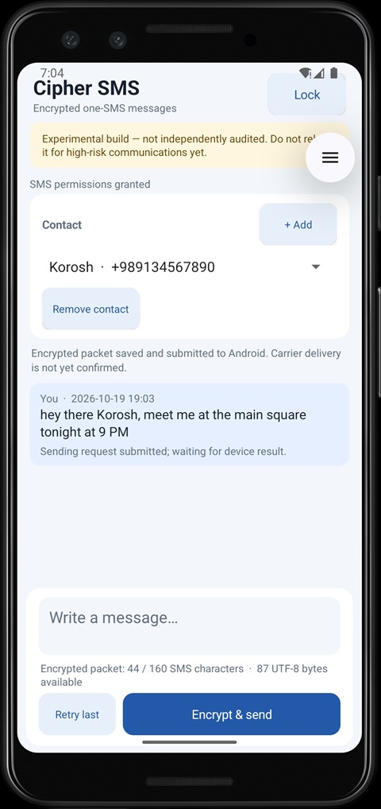

# CipherSMS — Experimental Android SMS Encryption

**Version:** `0.1.0-beta.1`  
**Status:** Early beta — volunteer testing  
**Platform:** Android 9 (API 28) and later  
**License:** MIT

CipherSMS is an experimental Android application that encrypts text messages before sending them through ordinary SMS. It is written in Java and uses AES-256-GCM authenticated encryption, HKDF-SHA-256 key derivation, and manually exchanged per-contact secrets.

This beta is intended for people willing to test the application, identify bugs, and provide feedback. It is **not a finished or independently security-audited secure messenger**.

**Do not use CipherSMS for sensitive, high-risk, emergency, or otherwise critical communications. Use sample messages only while testing.**

## Screenshot

<hr>
## Download the beta

Download the APK from the official GitHub release:

**[Download CipherSMS v0.1.0-beta.1](https://github.com/spiritofthenight/CipherSMS/releases/tag/v0.1.0-beta.1)**

On the release page, download `app-debug.apk` under **Assets**.

This is a debug-signed testing build. You may need to allow your browser or file manager to install apps from that source in Android settings. Only install APKs you obtained from the official release page.

### Requirements

- Android 9 or later.
- Two Android phones with working SIM cards and SMS service for end-to-end testing.
- SMS permissions granted to CipherSMS.
- A way to exchange contact secrets securely through a separate channel.

SMS charges or carrier restrictions may apply.

## Quick start: test with two phones

CipherSMS encrypts messages using a shared secret configured for each contact. Both participants must set up the same secret for their relationship.

### 1. Install and configure the app

Install the beta APK on both phones and open the application.

On each phone:

1. Enter that phone's own mobile number in international E.164 format, including `+` and the country code. For example, `+14155550123` is a fictional example number.
2. Choose a strong vault password.
3. Choose a different emergency password.
4. Complete the initial setup and grant the requested SMS permissions.

**There is no password recovery.** Keep your passwords safe. For this beta, do not use a password that protects important personal accounts.

### 2. Add each other as contacts

Choose one phone to initiate the contact setup.

1. Open **Add contact**.
2. Enter the other participant's name and mobile number in E.164 format.
3. Tap **Generate key**.
4. Exchange the displayed 64-character hexadecimal secret through a separate, trusted channel.
5. On the other phone, add the first participant as a contact and enter the same secret.

Each phone must use the other participant's number as its contact number. Both participants must enter the same secret for this relationship.

**Never send the secret key through SMS or include it in a public bug report.** Avoid clipboard history and cloud-synced notes when handling key material. Use a fresh random secret for every contact relationship; never reuse one across different contacts.

### 3. Send a test message

1. Send a short, non-sensitive message from the first phone to the second.
2. Check that the second phone receives and displays the original plaintext.
3. Reply from the second phone to the first.
4. Check whether acknowledgments and delivery status behave as expected.

Repeat with different message lengths, punctuation, and non-English characters. Keep test messages short enough to fit within the app's single-SMS limit.

## What to test

We need feedback from real devices, Android versions, and mobile networks. Please try the following where possible:

- **Basic messaging:** Send and receive in both directions.
- **Message length:** Test short messages and messages near the permitted limit.
- **Text compatibility:** Try punctuation, accented characters, and non-English text.
- **Acknowledgments:** Check whether the sender's status changes after the recipient app accepts a message.
- **Retries:** Where the app allows it, test retry behavior without creating duplicate messages.
- **Locked app:** Receive a message while CipherSMS is locked, then unlock it and check whether the message is processed correctly.
- **Restart and reboot:** Check behavior after closing the app or restarting the phone.
- **Network conditions:** Where practical, test delayed SMS delivery and messages arriving out of order.
- **Invalid input:** Try incorrect contact secrets and other invalid inputs without using real personal data.
- **Setup and recovery:** Test normal-password failures and the emergency reset only with disposable test data.

Please do not deliberately test with real sensitive messages, real secrets you cannot afford to lose, or data that you need to recover.

Not every test is expected to pass perfectly in this early beta. Unexpected behavior is useful feedback.

## Reporting bugs and feedback

Please report bugs through the repository's GitHub Issues page:

**[Report an issue](https://github.com/spiritofthenight/CipherSMS/issues)**

A useful report includes:

- The Android version and phone manufacturer/model.
- Whether the issue occurred on the sender, recipient, or both.
- The steps needed to reproduce it.
- What you expected to happen and what actually happened.
- Whether the problem is consistent or intermittent.
- Relevant error messages, with private information removed.

Never include passwords, contact secrets, decrypted message contents, phone numbers, or other private information in an issue. Redact screenshots and logs before sharing them.

Please mention that you tested `v0.1.0-beta.1` so we know which version you're using.

## What is implemented

The current implementation includes:

- A local vault protected by Argon2id, with AES-GCM-encrypted storage.
- Separate normal and emergency passwords. Failed normal-password attempts trigger escalating delays; the emergency password initiates deletion of app-owned data and fresh setup.
- Manually exchanged 32-byte per-contact secrets, represented as 64 hexadecimal characters.
- Direction-specific AES-256-GCM keys derived using HKDF-SHA-256 and the sender and recipient's E.164 phone numbers.
- A fresh random 12-byte nonce and full 16-byte GCM authentication tag for each new packet.
- Base64 SMS transport with a single-segment send-time check.
- A 4-byte unsigned per-direction counter and a 64-packet replay window. Valid unseen packets can arrive out of order within the window; duplicates and packets too far behind the highest accepted counter are rejected.
- Encrypted app-level acknowledgments and exact-packet retry behavior.
- An incoming SMS receiver that queues candidates while the app is locked. Queued bodies are encrypted at rest using an app-specific Android Keystore AES-GCM key.
- Backup/data-transfer exclusions, screen-capture blocking, generic incoming notifications, and bounded message and pending-packet queues.
- Unit tests covering packet round trips, directional key separation, tamper rejection, encoded size boundaries, an HKDF RFC 5869 test vector, and replay-window behavior.

This feature list describes implemented functionality, not a guarantee that every behavior is bug-free or that the design has been independently verified.

## SMS message length

CipherSMS sends encrypted packets as Base64 text over SMS and refuses to send a message if Android reports that the encoded body requires more than one SMS segment.

The protocol has 33 bytes of fixed overhead: a 1-byte version/type field, a 4-byte counter, a 12-byte nonce, and a 16-byte AES-GCM authentication tag. The current plaintext ceiling is **87 UTF-8 bytes**.

The number of visible characters you can send may be lower when using non-ASCII text. The app checks the encoded message size and blocks messages that exceed the permitted limit rather than silently splitting them.

## Acknowledgments and delivery status

The recipient app sends an encrypted acknowledgment after it authenticates a text packet and commits the message and replay state to the encrypted vault.

An acknowledgment means the **recipient app accepted the message**. It does not mean a human has read it.

Carrier delivery reports, SMS delivery, and acceptance by CipherSMS are different things. A carrier may delay or suppress a message or acknowledgment. If an acknowledgment does not arrive, the sender may retry the exact original packet. Duplicate packets should not display the same message twice.

## Security and privacy limitations

CipherSMS is experimental software. The cryptographic primitives used by the application do not, by themselves, establish that the complete application or protocol is secure.

Please understand these limitations before testing:

- **No independent security audit:** The application and its protocol have not been independently audited. Bugs or design weaknesses may expose messages or secrets.
- **SMS metadata remains visible:** Mobile carriers can observe sender and recipient information, timing, and traffic volume. SMS can be blocked, delayed, or delivered unpredictably.
- **System SMS storage:** Android or other applications may store or display the Base64 ciphertext. CipherSMS cannot control system SMS history, third-party applications, screenshots taken elsewhere, or backups outside its control.
- **No guarantee of physical data erasure:** Emergency reset attempts to delete app-private data and keys. Flash storage may retain remnants, and the app cannot erase copies owned by Android, the SMS provider, or third parties.
- **Symmetric contact secrets:** Anyone who knows a contact's shared secret may be able to create valid packets for that relationship. This design does not provide per-message non-repudiation against the other participant.
- **Platform and carrier differences:** SMS behavior can vary across Android versions, device manufacturers, SIMs, and mobile networks. The app relies on SMS permissions and system broadcasts and is not the default SMS app.
- **No password recovery:** Losing the vault password may mean losing access to the app's protected data.
- **Experimental recovery behavior:** Lockouts, emergency reset, message queuing, retries, and process recovery require further real-device testing.

Use disposable test data and treat all behavior as unverified until tested in your own environment.

## Build from source

You can build CipherSMS using Android Studio or a compatible command-line environment.

### Requirements

- Android Studio with Android SDK Platform 37 installed.
- Java 17.
- The Gradle Wrapper included in the repository.
- Internet access to resolve Gradle plugins and dependencies.

### Build the debug APK

Clone the repository:

```bash
git clone https://github.com/spiritofthenight/CipherSMS.git
cd CipherSMS
```

Build the APK:

```bash
chmod +x gradlew
./gradlew assembleDebug
```

The generated APK should be located at:

```text
app/build/outputs/apk/debug/app-debug.apk
```

Alternatively, open the project directory in Android Studio, allow Gradle to sync, and run the app on an Android 9+ device.

The project uses Android Gradle Plugin 8.13.2, Gradle 8.13, Java 17, Bouncy Castle 1.86, libphonenumber 9.0.41, and JUnit 4.13.2.

## Project documentation

- [`PROTOCOL.md`](PROTOCOL.md) — Packet format, key derivation, counters, replay window, and acknowledgments.
- [`SECURITY.md`](SECURITY.md) — Threat model, vault protection, emergency reset, and security limitations.

## License

CipherSMS is released under the MIT License. See [`LICENSE`](LICENSE) for the full text.

## A note to testers

Thank you for helping test CipherSMS. This beta is an early step toward evaluating whether encrypted one-part SMS messaging can work reliably across real Android devices and mobile networks.

Honest reports about failures, confusing behavior, and usability problems are especially valuable. Please test carefully, protect your secrets, and remember that this release is for experimentation not high-risk communication.
